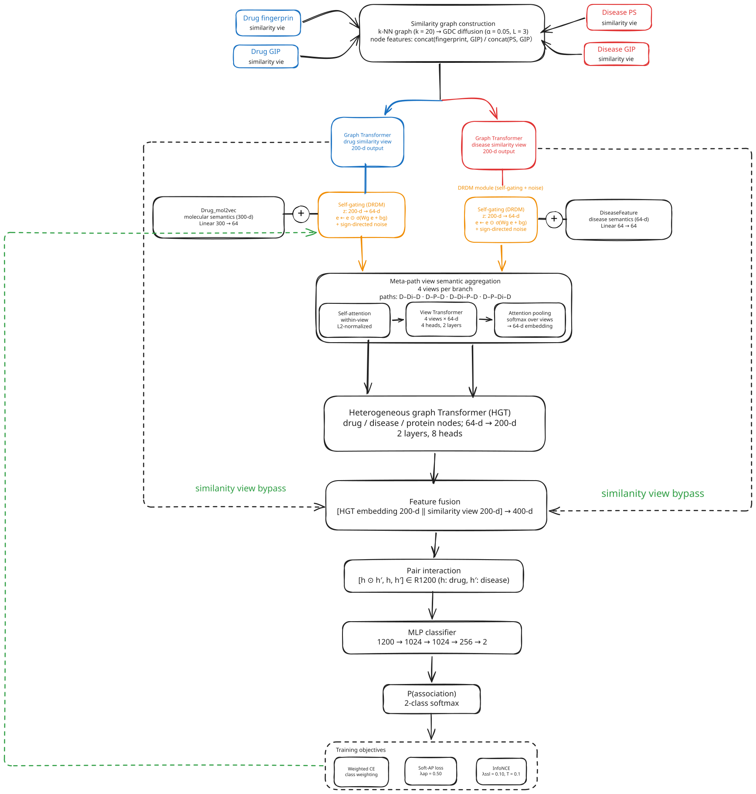

# MDART

**A Multi-view Network-Transformer framework for Drug-Disease Association prediction**

本仓库是 **MDART** 的官方实现——一个面向**药物重定位（drug repositioning）**的
药物–疾病关联（Drug–Disease Association, DDA）预测模型。模型以**多视图元路径学习**为核心，
配合**相似度图多尺度扩散、排序感知损失与联合训练策略**，在极端不平衡的药物–疾病候选空间上
直接优化排序质量；仓库提供 20+ 个逐项可开关的组件开关，便于做完整消融。

> **仓库定位**：论文投稿配套代码（可复现 + 可消融）。
> 数据集（B / C / F）已随仓库提供，`python train_DDA.py` 即可跑通 10 折交叉验证。

---

## 目录

- [1. 方法概览](#1-方法概览)
- [2. 模型设计](#2-模型设计)
- [3. 仓库结构](#3-仓库结构)
- [4. 环境配置](#4-环境配置)
- [5. 数据集](#5-数据集)
- [6. 快速开始](#6-快速开始)
- [7. 超参数与开关说明](#7-超参数与开关说明)
- [8. 案例分析（阿尔茨海默病）](#8-案例分析阿尔茨海默病)
- [9. 显存需求](#9-显存需求)
- [引用](#引用)
---
## 架构图


## 1. 方法概览

MDART 把 DDA 预测建模为 **药物–疾病对的二分类 + 排序问题**，整体由五个部件串联：

```text
                        ┌──────────────────────────────────────────────┐
                        │  Drug / Disease 相似度图 (GDC 扩散后 KNN)      │
    DrugFingerprint ┐   │  ┌────────────────┐   ┌─────────────────┐    │
    DrugGIP         ├──▶│  │ GraphTransformer│   │ GraphTransformer│    │
    DiseasePS       │   │  │   (drug view)   │   │ (disease view)  │    │
    DiseaseGIP      ┘   │  └───────┬────────┘   └────────┬────────┘    │
                        └──────────┼─────────────────────┼────────────┘
                                   ▼                     ▼
                            z_drug (200d)         z_disease (200d)
                                   │                     │
    Drug_mol2vec ──┐               │                     │        ┌── DiseaseFeature ──┐
                   ├── 残差注入 ───┤                     ├────────┤  残差注入          │
                   │               ▼                     ▼        └────────────────────┘
                   │        ┌─────────────┐       ┌──────────────┐
                   │        │ Self-Gating │       │ Self-Gating  │  ← DRDM 去偏
                   │        │ + 符号噪声  │       │ + 符号噪声   │
                   │        └──────┬──────┘       └──────┬───────┘
                   │               │                     │
                   │        ┌──────▼─────────────────────▼───────┐
                   │        │  4 条元路径视图语义聚合             │
    Protein_ESM ───┼──▶     │  Self-Attn → 跨视图 Transformer     │
                   │        │  → 可微视图注意力池化               │
                   │        └──────────────┬─────────────────────┘
                   │                       ▼
                   │              HGT 异构编码 (drug/disease/protein)
                   │                       ▼
                   │        ┌── 拼接相似度视图 ──▶ 交互: [h⊙h', h, h'] ──┐
                   │        │                                            │
                   │        └──▶ MLP 打分头 (256→2) ◀────────────────────┘
                   │                       ▼
                   │              P(association) + 排序损失
                   └───────────────────────────────────────────────────
```

**四个元路径视图**（`data_preprocess.dgl_heterograph`，药物侧 / 疾病侧对称）：

| # | 药物侧元路径 | 疾病侧元路径 | 语义 |
|---|---|---|---|
| 1 | drug–disease–drug | disease–protein–disease | 同疾病共药 / 同蛋白共病 |
| 2 | drug–protein–drug | disease–drug–disease | 共享靶点 / 共享药物 |
| 3 | drug–disease–protein–drug | disease–protein–drug–disease | 疾病→靶点→药物的三跳闭合 |
| 4 | drug–protein–disease–drug | disease–drug–protein–disease | 靶点→疾病→药物的三跳闭合 |

---

## 2. 模型设计

### 2.1 多视图元路径的**可微**聚合

药物与疾病各有 4 条元路径视图，聚合过程全程可微，不做任何硬性裁剪，因此每条视图都能持续接收梯度：

1. **视图内自注意力精炼**（`SelfAttentionLayer`）——在视图送入元路径聚合前先做一次
   Q/K/V 自注意力 + `output` 投影 + 残差，使节点表示携带同类节点上下文；
2. **跨视图 Transformer**（`drug_trans` / `disease_trans`）——在 4 条视图构成的序列上做自注意力，
   显式建模视图间依赖；
3. **可微视图注意力池化**（`view_attn_sem_*`）——`softmax` 学习权重后加权求和为单一语义视图，
   权重 $\beta_m(u)$ 逐节点计算，可直接导出为**视图重要性**的可解释性证据。

> 配套的**显存设计**：语义视图先在 HGT **之前**池化成 1 条，HGT 只前向 1 次。
> 若让每条视图各自过一遍 HGT，显存会随视图数线性增长，单卡实测直接 OOM；
> 池化后再过 HGT 使 HGT 的开销与视图数解耦，这是支撑 4 视图可训练的关键工程取舍。

### 2.2 相似度图的**多尺度建模**

`k_matrix` 只保留 KNN 局部邻居，长程相似性无法传导。`gdc_diffusion` 引入
**Graph Diffusion Convolution** 核：

$$S = \sum_{i=0}^{K} \alpha (1-\alpha)^i A_{\text{norm}}^i,\qquad A_{\text{norm}} = D^{-1/2} A D^{-1/2}$$

再对 $S$ 做 top-k 稀疏化 + 对称化 + 补自环，把单尺度 KNN 图扩展为多尺度扩散图
（`--gdc_alpha 0.05 --gdc_order 3`）。

同时相似度图的**节点特征**取**多视图拼接** `[drf ‖ drg]`、`[dip ‖ dig]`
（`--use_multi_sim_feat`），让分子指纹与 GIP 核的互补信息都进入 GraphTransformer。

### 2.3 **排序感知**的 AP 代理损失 + 低秩难负样本挖掘

正负比极端不平衡（C-dataset 正样本仅 **0.93%**，F-dataset **1.04%**），此时
Accuracy / AUC 与 **AUPR** 会严重脱节。`ap_loss.soft_ap_loss` 构造可微 AP：

$$\widehat{\text{rank}}_i=\sum_j \sigma\!\left(\frac{s_j - s_i}{\tau}\right),\qquad
\mathcal{L}_{\text{AP}} = 1 - \frac{1}{|P|}\sum_{i \in P} \frac{1}{\widehat{\text{rank}}_i}$$

- **低秩残差难例挖掘**（`rank=2`）：对 drug×disease 负样本得分矩阵做截断 SVD
  $M \approx UV^{\top}$，用**残差** $r = s - \text{lowrank}$ 排序难例——捕捉"超出全局趋势之外仍被高估"
  的信息性难例，而非仅取绝对高分者（SVD 失败自动回退 top-k）。
- **动态负采样**：负/正比随 epoch 从 `3%` 线性爬升到 `50%`，早期易训练、后期逼近真实分布。
- **AP 权重两阶段 ramp**：0→0.05（30 epoch 预热）→0.50（270 epoch 线性），使 AP 损失升为 co-primary。

### 2.4 对比学习 × 对抗扰动 × 梯度平衡的联合训练

| 组件 | 实现位置 | 作用 |
|---|---|---|
| **跨模态 InfoNCE** | `MAPTrans.ssl_loss_cross` | 分层采样保证正负比 ≥ 1:2，分块计算避免 $N^2$ 显存 |
| **视图间 InfoNCE** | `MAPTrans.ssl_loss_views` | 语义视图 ↔ 相似度视图互为正样本（`--use_fuse_ssl`） |
| **SSL 投影头解耦** | `ssl_projector` / `ssl_projector_fuse` | SimCLR 式做法，对比空间不污染分类表示 |
| **FGSM 对抗扰动** | `train_DDA.py` + `perturb_embedding` | 对门控特征求 sign 梯度，二次前向重算损失（`--use_adv`） |
| **梯度一致性平衡** | `train_DDA.py` 方向 F | 用 $\cos(g_{\text{CE}}, g_{\text{AP}})$、$\cos(g_{\text{CE}}, g_{\text{SSL}})$ 缩放辅助损失权重 |

### 2.5 特征注入与去偏

原始语义特征（mol2vec 300 维、DiseaseFeature 64 维）经独立投影层以**残差**方式注入语义空间，
与相似度图编码结果相加，使分子/疾病语义信息全程保留在表征中（`--use_raw_feat`）：

$$\mathbf{z}_r = W_r\mathbf{s}_r + W_r^{\text{raw}}\mathbf{x}_r^{\text{mol2vec}},\qquad
\mathbf{z}_i = W_i\mathbf{s}_i + W_i^{\text{raw}}\mathbf{x}_i^{\text{DiseaseFeature}}$$

在此之上叠加 **DRDM 去偏**：Self-Gating 按通道自适应缩放特征，
并以符号定向噪声增强鲁棒性（`--use_gating`）：

$$g(\mathbf{z}) = \mathbf{z}\odot\sigma(\mathbf{z}W_g + \mathbf{b}_g)$$

门偏置初始化为 2.0，使初始门近似"全开"，避免训练初期特征被压制。

### 2.6 显存优化

C-dataset 训练集约 24.4 万样本，打分 MLP 单次前向激活约 12 GB。除 2.1 的视图池化外：

- `--use_ckpt` 按 `(Linear+ReLU+Dropout)` 把打分 MLP 切成 4 段做**梯度检查点**，
  峰值降到约 1 GB/段（数学等价）；对 torch<1.10 提供兼容 `.grad()` 的自定义
  `_CheckpointedMLPBlock`（官方 reentrant 检查点与 FGSM/梯度平衡所需的 `autograd.grad` 不兼容）；
- AP 损失的 `diff` 矩阵按正样本分块、InfoNCE 分母按 4096 分块，避免物化超大矩阵；
- FGSM 第一次前向后显式释放计算图并 `empty_cache()`，两次计算图不共存。

### 2.7 组件与开关总览

| 维度 | MDART |
|---|---|
| 元路径视图 | **全部 4 条**参与，可微注意力池化 |
| 视图聚合 | 视图内自注意力 + 跨视图 Transformer + 逐节点注意力池化 |
| 相似度图 | **GDC 多尺度扩散**，节点特征 `[drf‖drg]` / `[dip‖dig]` |
| 视图融合 | 语义视图池化 → HGT 1 次 → 与相似度视图拼接 |
| 配对交互 | `[h⊙h' ‖ h ‖ h']`（`--use_inter_cat`） |
| 损失 | CE(√类别加权) + **可微 AP**(低秩残差难例) + **跨模态/视图间 InfoNCE** |
| 训练策略 | CE/AP/SSL 权重预热 ramp + **FGSM 对抗** + **梯度一致性平衡** |
| 蛋白编码 | 2 层 MLP + LayerNorm（`--use_prot_mlp`） |
| 去偏 | DRDM Self-Gating + 符号定向噪声（`--use_gating`） |
| 特征注入 | mol2vec / DiseaseFeature 残差投影（`--use_raw_feat`） |
| 简化口径对照 | `--use_orig_view 1` 切到简化视图口径（消融用） |

---

## 3. 仓库结构

```text
.
├── MDART.py                       # 主模型：多视图聚合 + HGT + 相似度视图融合 + SSL/门控
├── train_DDA.py                      # 10 折交叉验证训练入口（推荐入口）
├── data_preprocess.py                # 数据读取、KNN/GDC 相似度图、元路径异构图、k 折划分
├── ap_loss.py                        # 可微 AP 代理损失 + 低秩残差难负样本挖掘
├── metric.py                         # AUC / AUPR / Accuracy / Precision / Recall / F1 / MCC
├── case_study_Alzheimer.py           # 案例研究：冷启动口径（屏蔽全部 AD 相关配对）
├── case_study_Alzheimer_keep_known.py# 案例研究：非冷启动口径（保留已知 AD 药）
├── map_case_study_drugs.py           # 案例结果 CSV 的药物索引 → DrugBank ID/名称 离线重映射
├── model/
│   ├── gt_net_drug.py                # 药物相似度图 GraphTransformer（含边特征注意力）
│   ├── gt_net_disease.py             # 疾病相似度图 GraphTransformer
│   └── graph_transformer_layer.py    # 早期独立版本，当前未被引用（保留供追溯）
├── data/                             # B / C / F 三个数据集（见第 5 节）
├── requirements.txt
├── LICENSE
└── README.md
```

---

## 4. 环境配置

验证过的运行环境（论文结果所用）：

| 组件 | 版本 |
|---|---|
| Python | 3.9 |
| PyTorch | 1.10.0 |
| dgl | 0.9.0 |
| CUDA | 11.3.1 |
| numpy | 1.23.1 |
| pandas | 2.x |
| scipy | 1.10.x |
| scikit-learn | 0.24.2 |
| networkx | 2.8.4 |
| matplotlib | 3.x |

```bash
conda create -n MDART python=3.9 -y
conda activate MDART

# PyTorch 1.10 + CUDA 11.3
pip install torch==1.10.0+cu113 torchvision==0.11.1+cu113 \
    -f https://download.pytorch.org/whl/torch_stable.html

# dgl 0.9.0（cu113 轮子）
pip install dgl-cu113==0.9.0 -f https://data.dgl.ai/wheels/repo.html

pip install -r requirements.txt
```

> **dgl 安装提示**：dgl 的 wheel 必须与 torch / CUDA 版本严格匹配。
> 若使用其他 CUDA 版本，请把上面的 `cu113` 换成对应后缀，
> 或参考 [DGL 官方安装指引](https://www.dgl.ai/pages/start.html)。
> CPU-only 环境可安装 `dgl==0.9.0` 并把 `--use_ckpt` 置 0（无显存压力）。

---

## 5. 数据集

仓库内置三个公开数据集，均位于 `data/<dataset>/`：

| 数据集 | 药物数 | 疾病数 | 蛋白数 | 已知关联 (正样本) | 候选总数 | 正样本占比 |
|---|---|---|---|---|---|---|
| **B-dataset** | 269 | 598 | 1 021 | 18 416 | 160 862 | 11.45% |
| **C-dataset** | 663 | 409 | 993 | 2 532 | 271 167 | **0.93%** |
| **F-dataset** | 592 | 313 | 2 741 | 1 933 | 185 296 | **1.04%** |

`C` 与 `F` 属于**极端不平衡**设定（正样本不足 1.1%），这也是模型以 **AUPR 为主指标**、
并引入 AP 代理损失的直接原因。

### 每个数据集的必需文件

| 文件 | 维度 / 含义 |
|---|---|
| `DrugFingerprint.csv` | 药物分子指纹，`drf`（269 / 663 / 592 维） |
| `DrugGIP.csv` | 药物 GIP 核相似度，`drg` |
| `Drug_mol2vec.csv` | 药物 mol2vec 语义特征，**300 维** |
| `DiseasePS.csv` | 疾病语义相似度，`dip` |
| `DiseaseGIP.csv` | 疾病 GIP 核相似度，`dig` |
| `DiseaseFeature.csv` | 疾病语义特征，**64 维**（首列疾病标识，如 `D104300`=阿尔茨海默病） |
| `Protein_ESM.csv` | 蛋白 ESM 序列嵌入，**320 维** |
| `DrugDiseaseAssociationNumber.csv` | 药物–疾病正样本 `(drug_idx, disease_idx)` |
| `DrugProteinAssociationNumber.csv` | 药物–蛋白关联 |
| `DiseaseProteinAssociationNumber.csv` | 疾病–蛋白关联 |
| `ProteinDrugAssociationNumber.csv` | 蛋白–药物关联（反向） |
| `DiseaseDrugAssociationNumber.csv` | 疾病–药物关联（反向） |
| `ProteinDiseaseAssociationNumber.csv` | 蛋白–疾病关联（反向） |
| `DrugInformation.csv` | 药物 DrugBank ID / 通用名（案例分析用） |
| `AllNode.csv` / `Allnode.csv` | 节点清单（案例分析 ID 回退映射用） |

> `fold/0..9/{data_train,data_test}.csv` **不入库**：`data_preprocess.k_fold` 在训练开始时
> 自动生成并写入 `data/<dataset>/fold/`。

---

## 6. 快速开始

```bash
# 默认：F-dataset，10 折交叉验证，600 epoch
python train_DDA.py

# 指定数据集
python train_DDA.py --dataset C-dataset
python train_DDA.py --dataset B-dataset

# 快速冒烟测试（少量 epoch，确认环境跑通）
python train_DDA.py --dataset F-dataset --k_fold 2 --epochs 5 --use_adv 0 --use_ckpt 0
```

`train_DDA.py` 每个 epoch 打印一行：

```text
Epoch   Time    AUC     AUPR    Accuracy  Precision  Recall   F1-score  Mcc      AP-loss
```

**模型选择准则**：以每个 fold 内**测试集 AUPR 最高**的 epoch 作为该 fold 的最优指标
（`if AUPR > best_aupr`），10 折结束后输出各指标的 mean / std。选择 AUPR 而非 AUC 是因为
极端不平衡下 AUPR 更能反映排序质量。

---

## 7. 超参数与开关说明

### 7.1 基础超参数（`train_DDA.py`）

| 参数 | 默认 | 说明 |
|---|---|---|
| `--dataset` | `F-dataset` | `B-dataset` / `C-dataset` / `F-dataset` |
| `--k_fold` | `10` | 交叉验证折数 |
| `--epochs` | `600` | 训练轮数 |
| `--lr` | `1e-4` | 学习率 |
| `--weight_decay` | `1e-3` | Adam 权重衰减 |
| `--random_seed` | `1234` | 全局随机种子 |
| `--neighbor` | `20` | KNN / GDC 稀疏化邻居数 |
| `--dropout` | `0.4` | Dropout 比例 |
| `--gt_layer` / `--gt_head` | `2` / `2` | 相似度图 GraphTransformer 层数 / 头数 |
| `--gt_out_dim` | `200` | GraphTransformer 输出维度 |
| `--hgt_layer` / `--hgt_head` | `2` / `8` | 异构 HGT 层数 / 头数 |
| `--hgt_in_dim` | `64` | HGT 输入维度（= 语义视图维度） |
| `--hgt_head_dim` | `25` | HGT 每头维度 |
| `--tr_layer` / `--tr_head` | `2` / `4` | 跨视图 Transformer 层数 / 头数 |

### 7.2 核心组件开关（默认全开；置 `0` 即为对应消融）

| 参数 | 默认 | 所属模块 | 作用 |
|---|---|---|---|
| `--use_gdc` | `1` | 多尺度相似度图 | GDC 图扩散开关 |
| `--gdc_alpha` / `--gdc_order` | `0.05` / `3` | 多尺度相似度图 | 扩散跃迁概率 / 阶数 |
| `--use_multi_sim_feat` | `1` | 多尺度相似度图 | 相似度图节点特征多视图拼接 `[drf‖drg]` |
| `--num_metapaths` | `4` | 多视图元路径聚合 | 参与聚合的元路径视图数（`2` = 只取 2 条视图） |
| `--use_view_trans` | `1` | 多视图元路径聚合 | 跨视图 Transformer 编码 |
| `--use_view_pool` | `1` | 多视图元路径聚合 | 可微视图注意力池化（`0` = 均匀平均） |
| `--use_inter_cat` | `1` | 配对交互 | 交互表征 `[h⊙h'‖h‖h']`（`0` = 纯 Hadamard） |
| `--use_ap` | `1` | 排序感知损失 | AP 代理损失开关 |
| `--use_lowrank_ap` / `--ap_rank` | `1` / `2` | 排序感知损失 | 低秩残差难负样本 / 秩 |
| `--use_ssl` | `1` | 联合训练 | 全部对比学习（跨模态 + 视图间） |
| `--use_fuse_ssl` | `1` | 联合训练 | 视图间 InfoNCE |
| `--use_adv` / `--adv_eps` / `--adv_warmup` | `1` / `0.01` / `50` | 联合训练 | FGSM 对抗扰动 / 幅度 / 预热 epoch |
| `--use_grad_balance` / `--gb_warmup` | `1` / `50` | 联合训练 | 梯度一致性平衡 / 预热 epoch |
| `--use_gating` | `1` | DRDM 去偏 | Self-Gating + 符号定向噪声 |
| `--use_raw_feat` | `1` | 特征注入 | mol2vec / DiseaseFeature 残差注入 |
| `--use_prot_mlp` | `1` | 蛋白编码 | 蛋白 2 层 MLP + LayerNorm（`0` = 单层 linear） |
| `--use_ce_weight` | `1` | 训练策略 | CE 类别加权 $\sqrt{\text{neg}/\text{pos}}$（`0` = 1:1） |
| `--use_ckpt` | `1` | OOM 修复 | 打分 MLP 分块梯度检查点 |

### 7.3 简化视图口径开关（消融用）

| 参数 | 默认 | 作用 |
|---|---|---|
| `--use_orig_view` | `0` | 置 `1` 切换到**简化视图口径**：视图数固定为 2、每条视图各自过一遍 HGT、`3×gt_out_dim` 拼接、配对交互退化为纯 Hadamard。用于量化"多视图可微聚合 + 视图池化 + 主效应拼接"这一整套设计的贡献。 |
---

## 8. 案例分析（阿尔茨海默病）

两个互补口径，**不可混用同一 P 值比较**：

```bash
# 口径一：冷启动 —— 屏蔽全部 AD 相关配对（正负都不进训练），在含已知药的候选集内排序
python case_study_Alzheimer.py --dataset C-dataset --epochs 600 --topk 10

# 口径二：非冷启动 —— 保留已知 AD 药参与训练，仅在 unknown 候选内取 Top-K
python case_study_Alzheimer_keep_known.py --dataset C-dataset --epochs 600 --topk 10
```

输出 `Result/CaseStudy/AD_top10_<dataset>_s<seed>.csv`，字段：
`rank, drug_index, DrugBank_ID, drug_name, P(positive), known_AD_in_dataset`。

若 CSV 中 `DrugBank_ID` / `drug_name` 为纯数字（历史版本 ID 映射缺陷所致），用离线脚本重映射：

```bash
python map_case_study_drugs.py --csv Result/CaseStudy/AD_top10_C-dataset_s1234.csv \
                              --dataset C-dataset
```

> 输出的候选药物需**人工在 PubMed 逐条检索**确认文献佐证（PMID）后方可写入论文表格。

---

## 9. 显存需求

打分 MLP 的激活量与**训练样本数**成正比，`C-dataset`（约 24.4 万训练样本）是显存瓶颈：

| 数据集 | 训练样本量级 | 建议显存 | 建议配置 |
|---|---|---|---|
| B-dataset | ~14 万 | 8 GB 起 | `--use_ckpt 1` |
| C-dataset | ~24.4 万 | **建议 ≥ 12 GB** | 必须 `--use_ckpt 1`；8 GB 卡需下调 `--k_fold` 或分批 |
| F-dataset | ~16.7 万 | 8 GB 起 | `--use_ckpt 1` |

已有的显存优化：

1. `--use_ckpt`：打分 MLP 4 段梯度检查点（峰值 12 GB → ~1 GB/段）；
2. **AP loss 分块**：`diff` 矩阵按 512 个正样本分块，避免 `(P, P+K)` 全量展开；
3. **InfoNCE 分块**：分母按 4096 分块，避免物化 $N \times N$ 矩阵；
4. **FGSM 双前向**：第一次前向算完 `g_d/g_r` 后显式 `del` 并 `empty_cache()`，
   两次计算图不共存；
5. **adj 矩阵驻留 CPU**：`aggres` 中按需逐条 `.to(device)`。

---


## 引用

如果本工作对你的研究有帮助，请引用：

```bibtex
@article{mdart,
  title   = {MDART: Multi-view Network-Transformer Learning for Drug-Disease Association Prediction},
  author  = {TODO},
  journal = {TODO},
  year    = {TODO}
}
```

> 本仓库的可复现性参考了 MAPTrans 公开实现的工程结构，在此致谢。
